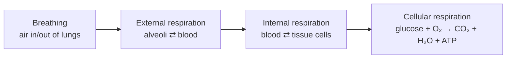
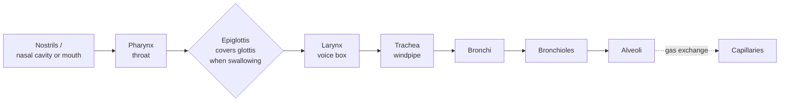
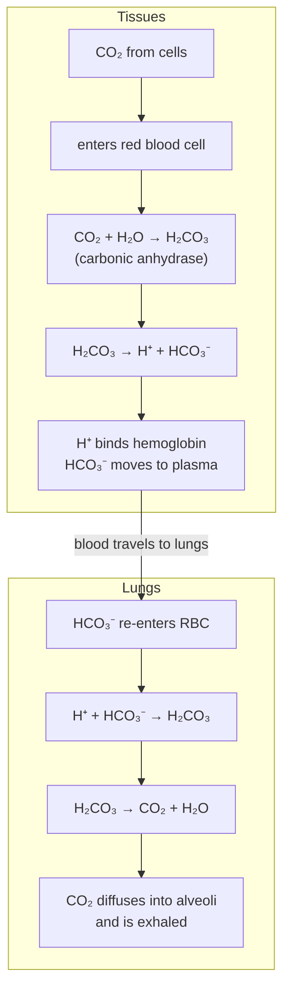

# Biology 20 Unit D – Body Systems
## Chapter 7: Respiratory System

![[bio20-ch7-cover-cartoon.png|260]]
*"The real reason dinosaurs became extinct"*

> [!info] How to read these notes
> Every blank from the handout is filled in **in bold**. The diagrams are clipped straight from the handout pages, and the blank labels and boxes are filled in with blue text.

---

## Chapter 7 Prequiz (p. 2)

1. In order to carry out cellular respiration, an animal cell must obtain → **B) glucose and oxygen**
2. As cells grow, they reach a volume at which they must → **D) undergo mitosis**
3. An organism that is made of many cells and obtains its nutrients by eating other organisms is probably a/an → **A) animal**
4. In order to carry out the process of mitosis, a plant cell must → **B) copy the chromosomes and build organelles required to separate them**
5. When a molecule of oxygen moves from the inside of a baggie where its concentration is 35% to the air where its concentration is 21%, the process most likely involved is → **C) diffusion**
6. A baggie permeable to glucose loses 1.00 g of glucose in 15.4 min at 21 °C. At 45 °C, the time required to lose 1.00 g will be → **A) less** *(higher temperature = faster particles = faster diffusion)*
7. In a plant leaf during the daytime, water moves from the veins into the palisade cells. The process most likely responsible is → **D) osmosis**
8. A baggie of distilled water is placed in a beaker of 10% glucose solution. You can speed up the rate of osmosis by → **C) increasing the concentration of glucose outside the baggie**
9. When oxygen moves into an animal cell, the first organelle it must interact with is the → **D) cell membrane**
10. When carbon dioxide enters a plant cell, the first organelle it must interact with is the → **A) cell wall**

---

## 7.1 Structures of the Respiratory System (p. 3)

The main functions of the respiratory system are to ensure that:
- a. **a continuous supply of oxygen (O₂) is delivered to the body's cells** (for cellular respiration)
- b. **carbon dioxide (CO₂), a waste product of cellular respiration, is removed from the body**

Two requirements of respiration are that:
- a. The surface area (respiratory surface) must be large enough for **gases to diffuse fast enough to meet the body's needs**
- b. Respiration must take place in **a moist environment**, because O₂ and CO₂ must be dissolved in water to diffuse across cell membranes

### Stages of Respiration

*Breathing* involves two basic processes:
1. **Inspiration** (inhalation) moves air from the external environment to **the lungs**.
2. **Expiration** (exhalation) moves air from **the lungs back to the external environment**.

**External respiration** is the exchange of O₂ and CO₂ between **the air in the alveoli and the blood in the capillaries**.

**Internal respiration** is the exchange of O₂ and CO₂ between **the blood in the capillaries and the body's tissue cells**.

**Cellular respiration** is the series of energy-releasing **chemical reactions** that take place inside the cells. Cellular respiration is the final stage in respiration. It is the only **stage that releases usable energy (ATP)**, and it helps the body maintain **homeostasis** by means of **the energy (ATP) and heat it releases**.

---

## Structures of the Respiratory Tract (p. 4)

![[bio20-ch7-respiratory-tract-labelled.png]]

> [!warning] Check two labels against your class key
> These labels are my reading of where each line points. Two of them could be swapped:
> - "ribs" and "intercostal muscles": both pairs of lines point at the chest wall, and the intercostal muscles sit between the ribs.
> - "lung (alveoli)" could be meant as just "lung".

### Pathway of air

The air we breathe (a mixture of **nitrogen (~78%), oxygen (~21%), carbon dioxide, water vapour and other gases**) enters the nasal cavity or mouth.
- The nasal cavity **filters** (cilia & mucus), **moistens** (mucus) & **warms** (capillaries) the air.
- **Folds of tissue (nasal conchae / turbinate bones)** in the upper nasal passage increase surface area and cause air to swirl, allowing it to become **warmed, moistened and cleaned (filtered)**.
- Ciliated cells in the upper respiratory tract **sweep mucus and trapped particles (dust, microbes) toward the pharynx** and throat to be coughed or sneezed out.
- The nasal cavity opens to the throat or **pharynx**, which branches into the **trachea** (windpipe) leading to the lungs, or the esophagus (leading to the stomach).
  - The **epiglottis** is a flap that covers the opening of the trachea (the **glottis**) when you swallow, so food goes down the esophagus.

The trachea is lined with **ciliated cells and mucus-producing (goblet) cells**, which produce mucus that acts as a second filter.
- The walls of the trachea are supported by semicircular **(C-shaped) rings of cartilage** that prevent them from collapsing.

---

### Larynx, Bronchi, Lungs & Alveoli (p. 5)

Air is carried down the trachea to the **larynx** (voice box), which is composed of 2 thin sheets of elastic ligaments called **vocal cords**.
- When you speak, the muscles around the larynx **contract, tightening the vocal cords**, and the vocal cords vibrate as air is forced out of their narrow space, making a sound.
- Vocal cords are protected by a thick **layer of cartilage (the thyroid cartilage)** (Adam's apple).

Past the larynx, the trachea branches into two **bronchi** (which also contain cartilage rings).
- Bronchi carry air to **each lung**, where they branch into smaller **bronchioles** within the lungs.
- Both bronchi and bronchioles contain **smooth muscle** and are lined with **cilia and mucus** to keep trapping particles. Bronchioles have no cartilage rings.

The right lung has three lobes, and the left lung has **two lobes** (leaving room for the heart).
- The outer surface of the lungs is surrounded by a double-layered **pleural membrane** with a thin space filled with fluid, causing the layers to adhere to each other, connecting the lungs to the **thoracic (chest)** cavity.
- This enables the lungs to expand and contract **along with the chest wall (thoracic cavity)**.
- Inflammation of the pleural membrane = **pleurisy**.

Each bronchiole ends in several clusters of **alveoli** (tiny air sacs). Surrounding each alveolus is a fine network of **capillaries** from the **pulmonary arteries** and the **pulmonary veins**. Gas exchange occurs between the **alveoli and the capillaries**, so that blood leaving the lungs has a high **oxygen** content.

Alveoli are lined with a lubricating film of **lipoproteins / phospholipids** (surfactant) that prevents:
- a) **the alveoli from collapsing when you exhale**
- b) **the moist inner walls of the alveoli from sticking together**, so the alveoli can reopen easily on the next breath

![[bio20-ch7-alveolus.svg|550]]
*Extra reference: alveoli, alveolar sacs and their capillary beds. (Public domain diagram, Wikimedia Commons, "Alveolus diagram.svg" by LadyofHats.)*

---

### Structures Table

| Structure | Description / Function |
|---|---|
| **alveoli** | Tiny, thin-walled air sacs at the ends of bronchioles; site of gas exchange (O₂ into blood, CO₂ out) with surrounding capillaries |
| **bronchiole** | Small branching airways inside the lungs; carry air from the bronchi to the alveoli; have smooth muscle, no cartilage |
| **bronchus (pl. bronchi)** | The two branches of the trachea; carry air into the right and left lungs; supported by cartilage rings |
| **diaphragm** | Dome-shaped sheet of muscle separating the thoracic and abdominal cavities; contracts (flattens) for inhalation and relaxes (domes) for exhalation |
| **epiglottis** | Flap of tissue that covers the glottis during swallowing so food enters the esophagus, not the trachea |
| **glottis** | The opening into the larynx/trachea (the space between the vocal cords) |
| **larynx** | The voice box; contains the vocal cords; protected by thyroid cartilage (Adam's apple) |
| **lung** | Paired organs of gas exchange in the thoracic cavity; right lung has 3 lobes, left lung has 2 |
| **nasal passages** | Filter (hairs, cilia, mucus), warm (capillaries) and moisten (mucus) incoming air |
| **nostril** | External openings of the nose through which air enters; hairs filter large particles |
| **pharynx** | The throat; shared passage for air and food, leading to the trachea and esophagus |
| **pleural membrane** | Double-layered, fluid-filled membrane around each lung that attaches the lungs to the chest wall so they move with it |
| **thoracic cavity** | The chest cavity that holds the lungs and heart; enclosed by the rib cage and diaphragm |
| **trachea** | The windpipe; carries air from the larynx to the bronchi; lined with cilia and mucus; held open by C-shaped cartilage rings |

![[bio20-ch7-respiratory-system-detailed.svg]]
*Extra reference: a detailed labelled diagram of the whole respiratory system. (Public domain diagram, Wikimedia Commons, "Respiratory system complete en.svg" by LadyofHats.)*

---

## 7.2 Breathing and Respiration (p. 6)

Two muscular structures control **breathing, by changing the volume of the thoracic cavity**:
1. **The diaphragm**: a dome-shaped layer of muscle that separates the **thoracic cavity** (containing the lungs) from the **abdominal cavity**.
2. **Intercostal muscles**: located **between the ribs**.

These muscles work simultaneously to move air **into and out of the lungs**.

**Pressure differences:** Air always moves from an area of **higher pressure to an area of lower pressure**. When the volume of the thoracic cavity increases, the air pressure in the lungs falls below atmospheric pressure, so air flows in. When the volume decreases, the pressure in the lungs rises above atmospheric pressure, so air is pushed out. *(Volume and pressure are inversely related.)*

### The Mechanics of Breathing

**A. Inhalation:**
1. **The intercostal muscles contract** → the rib cage moves out **and up**, and the dome-shaped diaphragm flattens **(contracts and moves down)**.
2. Chest volume **increases**, and air inside the thoracic cavity (in the lungs) is **at a lower pressure than the outside air**.
3. **Air rushes into the lungs (from high to low pressure).**

**B. Exhalation:**
1. Intercostal muscles and diaphragm **relax** → the rib cage moves in and **down**, and the diaphragm returns to dome-shaped.
2. Volume of the thoracic cavity **decreases**, causing air pressure in the lungs to **increase (above atmospheric pressure)**.
3. **Air is forced out of** the lungs to **the outside environment**.

**Summary:**

| | Inhalation | Exhalation |
|---|---|---|
| Intercostal muscles | contract | relax |
| Rib cage | moves up and out | moves down and in |
| Diaphragm | contracts, flattens, moves down | relaxes, domes, moves up |
| Thoracic volume | increases ↑ | decreases ↓ |
| Pressure in lungs | decreases ↓ (below atmospheric) | increases ↑ (above atmospheric) |
| Air flow | **in** | **out** |

![[bio20-ch7-inhalation-exhalation.png]]

### Pneumothorax (p. 7)

**Pneumothorax:** **a collapsed lung caused by air entering the pleural space (between the lung and the chest wall)**
- Air leaks out of the lung and is trapped **in the pleural cavity, between the lung and the chest wall**.
- The trapped air collapses the affected lung.
- Treatment: drain the air using a large needle with a **one-way valve**, which only allows air out.

### Respiratory Volume

A spirograph is a graph representing **the volume of air moved into and out of the lungs over time**. It includes:
- **Tidal volume (TV)**: the volume of air that is inhaled and exhaled in a normal breath at rest. *(~500 mL)*
- **Inspiratory reserve volume (IRV)**: the additional volume of air that can be inhaled beyond a normal breath.
- **Expiratory reserve volume (ERV)**: the additional amount of air that can be exhaled beyond a normal breath.
- **Vital capacity (VC)**: the total volume of air that can be moved in or out of the lung.

> [!important] Vital Capacity = **Tidal Volume + Inspiratory Reserve Volume + Expiratory Reserve Volume**
> VC = TV + IRV + ERV

- **Residual volume (RV)**: the volume of air that remains in the lungs and respiratory tract after fully exhaling → ensures that **the lungs (alveoli) do not collapse, and gas exchange can continue between breaths**.

*Total lung capacity = VC + RV*

![[bio20-ch7-spirograph.png]]

---

## External vs. Internal Respiration (p. 8)

![[bio20-ch7-gas-exchange-alveolus.png|450]]

**External respiration** occurs in the **lungs**, between the alveoli and the capillaries next to them.
- As blood moves away from the body tissues into the alveolar capillaries, it is **oxygen-poor (deoxygenated) and carbon dioxide-rich**.
- Oxygen from the air in the alveoli diffuses into the **blood (capillaries)**, and carbon dioxide diffuses into the **alveoli** to be exhaled.

**Internal respiration** occurs in cells, between the capillaries and the **body's tissue cells**.
- Oxygen diffuses from the **blood (capillaries)** into the oxygen-poor **tissue cells**, while carbon dioxide diffuses from the **tissue cells** into the **blood**.

> [!tip] Gases always diffuse from **high concentration → low concentration**.

| | External respiration | Internal respiration |
|---|---|---|
| Where | Lungs (alveoli ⇄ capillaries) | Body tissues (capillaries ⇄ cells) |
| O₂ moves | alveoli → blood | blood → tissue cells |
| CO₂ moves | blood → alveoli | tissue cells → blood |

---

## Oxygen Transport (p. 9)

Depends on 2 processes: **diffusion, and active transport by carrier proteins**. Once O₂ is in the blood, almost all of it is carried bound to **hemoglobin**.

In the alveoli, about 30% of the oxygen transfer to cells occurs by **diffusion**.
- **Carrier proteins** in alveolar cells carry oxygen across the cell membranes into **the blood (capillaries)**.

In the blood, 99% of the O₂ going to the cells is carried by **hemoglobin** (an oxygen-transporting protein in **red blood cells**), forming oxyhemoglobin (HbO₂).

$$\text{Hb} + \text{O}_2 \rightleftharpoons \text{HbO}_2$$

## Carbon Dioxide Transport

- 7% of CO₂ is carried **dissolved in the blood plasma**
- 23% is carried as **CO₂ bound to hemoglobin** (carbaminohemoglobin)
- 70% is dissolved and carried in the blood as **bicarbonate ions** (HCO₃⁻)

**Equation:**

$$\text{CO}_2 + \text{H}_2\text{O} \;\xrightarrow{\text{carbonic anhydrase}}\; \text{H}_2\text{CO}_3 \;\rightleftharpoons\; \text{H}^+ + \text{HCO}_3^-$$

*(carbon dioxide + water → carbonic acid → hydrogen ion + bicarbonate ion)*

This final reaction occurs in red blood cells, after which:
1. **CO₂ diffuses from the tissue cells into the plasma and into red blood cells, where the enzyme carbonic anhydrase speeds up its reaction with water to form carbonic acid (H₂CO₃).**
2. **Carbonic acid quickly dissociates into hydrogen ions (H⁺) and bicarbonate ions (HCO₃⁻).**
3. **The H⁺ ions bind to hemoglobin (so they don't lower blood pH), and the HCO₃⁻ ions diffuse out of the red blood cell into the plasma, where they are carried to the lungs.**
4. **At the lungs the reaction reverses: HCO₃⁻ re-enters the red blood cells and joins with H⁺ to form H₂CO₃, which breaks down into CO₂ + H₂O. The CO₂ diffuses into the alveoli and is exhaled.**

### Blood pH and the Carbonate Buffer
- Carbon dioxide is a guardian of blood pH, which is essential for survival.
- The buffer system in which carbon dioxide plays an important role is called the **carbonate (bicarbonate) buffer**.
- It is made up of bicarbonate ions and dissolved carbon dioxide, with carbonic acid.
- The carbonic acid can neutralize hydroxide ions (bases), which would increase the pH of the blood when added.
- The bicarbonate ion can neutralize hydrogen ions (acids), which would cause a decrease in the pH of the blood when added.
- Both increasing and decreasing pH is life threatening. *(Normal blood pH ≈ 7.35–7.45)*

---

## 7.3 Respiratory Health (pp. 10–11)

### Upper Respiratory Tract Infections

**1. Tonsillitis**
- **Inflammation/infection of the tonsils** (lymph tissue at the back of the throat), caused by bacteria or viruses.
- Symptoms: sore throat, painful swallowing, fever, swollen tonsils.
- Treated with antibiotics if bacterial; a tonsillectomy (removal) may be done if infections keep coming back.

**2. Laryngitis**
- **Inflammation of the larynx (voice box)**, usually from infection or overusing the voice.
- The vocal cords swell, so the voice becomes hoarse or is lost.
- Usually clears up on its own with rest.

### Lower Respiratory Tract Infections

**1. Bronchitis**
- **Inflammation of the bronchi**. Extra mucus is produced and the airways narrow, causing coughing and difficulty breathing.
- *Acute* bronchitis is caused by bacteria or viruses. *Chronic* bronchitis is long-term and often caused by smoking or air pollution, which damages the cilia.

**2. Pneumonia**
- **Infection of the alveoli** (caused by bacteria, viruses or fungi). The alveoli fill with fluid and white blood cells, which reduces gas exchange.
- *Lobar* pneumonia affects a whole lobe of the lung. *Bronchial* pneumonia affects patches throughout the lungs.

**3. Pleurisy**
- **Inflammation of the pleural membranes.** The membranes rub together, causing sharp chest pain when breathing.
- Often a complication of another infection, such as pneumonia.

**4. Emphysema**
- **A chronic disease in which the walls of the alveoli break down and lose their elasticity**, mainly caused by smoking.
- This leaves less surface area for gas exchange, and air gets trapped in the lungs. Breathing (especially exhaling) becomes very difficult.
- It is not curable. It is a form of COPD (chronic obstructive pulmonary disease).

**5. Cystic fibrosis**
- **A genetic (inherited) disorder** caused by a faulty gene that controls chloride ion transport across cell membranes.
- Very thick, sticky mucus builds up in the bronchioles, blocking the airways and trapping bacteria, which leads to frequent lung infections.
- It is not curable. It is managed with physiotherapy to loosen mucus, medications, and sometimes a lung transplant.

**6. Asthma**
- **A chronic condition in which the bronchioles become inflamed and constrict**, and extra mucus is produced, narrowing the airways.
- It is triggered by allergens (pollen, dust, pet dander), smoke, cold air, exercise or stress. Symptoms are wheezing, coughing, shortness of breath and chest tightness.
- It is treated with inhalers: bronchodilators relax the bronchiole smooth muscle, and corticosteroids reduce inflammation.

**7. Lung Cancer**
- **Uncontrolled cell division in lung tissue**, forming tumours that reduce the surface area for gas exchange and can spread (metastasize) to other organs.
- Most cases are caused by smoking (carcinogens in tobacco smoke). Other causes include radon, asbestos and air pollution.
- **Carcinoma:** **a cancer that starts in epithelial tissue** (the tissue lining body surfaces and passages, such as the lining of the bronchi). Most lung cancers are carcinomas.

**8. Tuberculosis (TB)**
- **A contagious bacterial infection of the lungs** (*Mycobacterium tuberculosis*), spread through the air when an infected person coughs or sneezes.
- The bacteria form small lumps (tubercles) that destroy lung tissue. Symptoms are a chronic cough (sometimes with blood), fever, weight loss and night sweats.
- It is treated with a long course of several antibiotics. Antibiotic-resistant strains are a growing problem.

### Detecting and Treating Lung Disorders

**1. CT Scan** (computed tomography)
- **A computer combines many X-ray images taken from different angles into detailed cross-sectional (3-D) images of the lungs.** It is used to detect tumours, emphysema damage and other lung problems early.

**2. DNA Analysis**
- **A patient's DNA (or a tumour's DNA) is examined for gene mutations.** This is used to diagnose genetic disorders such as cystic fibrosis, to identify people at higher risk of lung cancer, and to choose targeted treatments.

**3. Liposomes**
- **Tiny artificial fat (lipid) spheres used to deliver medicine or healthy genes directly to lung cells.** They are often inhaled, and they merge with cell membranes to release their contents. They are being researched for gene therapy, for example delivering a normal CF gene to the cells of cystic fibrosis patients.

---

> [!summary] Key ideas to remember
> - Air path: nasal cavity → pharynx → larynx → trachea → bronchi → bronchioles → alveoli
> - Breathing is driven by **pressure differences** created by the diaphragm and intercostal muscles.
> - **VC = TV + IRV + ERV**. Residual volume keeps the alveoli from collapsing.
> - O₂ is carried mostly on **hemoglobin** (99%). CO₂ is carried mostly as **bicarbonate** (70%).
> - **CO₂ + H₂O ⇌ H₂CO₃ ⇌ H⁺ + HCO₃⁻** (carbonic anhydrase) also buffers blood pH.
